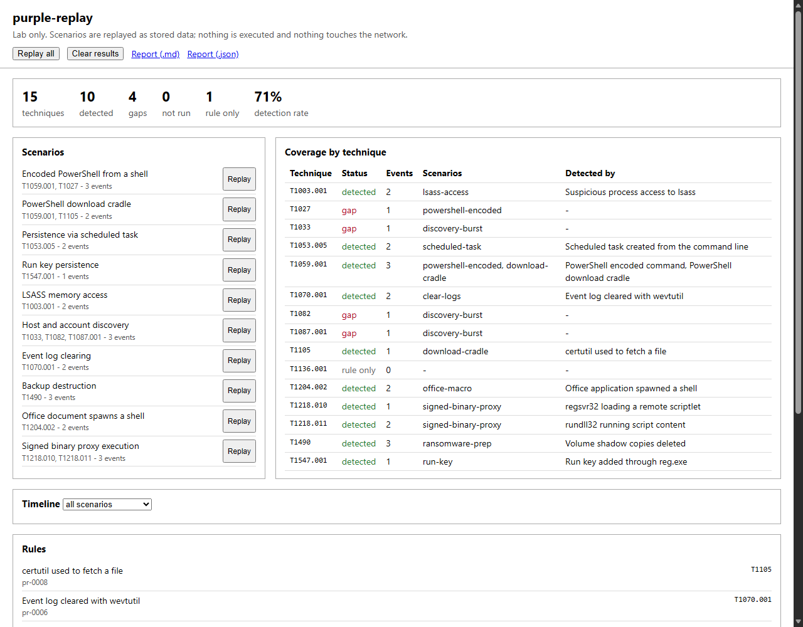

# purple-replay

A small local dashboard for checking detection rules against canned attack telemetry. Scenarios are JSON files containing made-up events (process creation, process access, event log) tagged with ATT&CK technique ids. Replaying one means loading those events into SQLite and running a Sigma-style rule set over them. Nothing is executed and nothing touches the network, so it is safe to run anywhere. It is for testing rules, not real endpoints.

The dashboard shows a per-technique coverage table (detected, gap, not run, rule only), an event timeline with the rules that fired on each event, and exports the same data as Markdown or JSON.

## Usage

Needs Node 24 or newer (developed on 26). No dependencies.

    node src/server.js [--port 8787] [--db data/replay.db]

Open http://127.0.0.1:8787, press "Replay all", and look at the coverage table. Without a browser:

    node src/cli.js          # Markdown report on stdout
    node src/cli.js --json
    node --test

The server binds to 127.0.0.1 only and rejects requests with a foreign Host or Origin header.

## Scenarios

`scenarios/*.json`: an id, a name and a list of events with `offset_ms`, `category`, `technique` and `fields`. Ten are included (encoded PowerShell, download cradle, scheduled task, Run key, LSASS access, discovery, log clearing, shadow copy deletion, Office macro child process, signed binary proxy). Some events are deliberately benign lookalikes that should not trigger anything. Files that fail validation are listed in the UI and skipped.

## Rules

`rules/*.yml`, twelve included. The Sigma subset supported:

- selections as a map (fields ANDed) or a list of maps (ORed); a field takes one value or a list (ORed, or ANDed with `|all`)
- modifiers `contains`, `startswith`, `endswith`, `re`, `all`; plain values are case-insensitive with `*` and `?` wildcards
- conditions with `and`, `or`, `not`, parentheses, `1 of x*`, `all of x*`, `1 of them`, `all of them`
- `logsource.category` is matched against the event category
- techniques come from `attack.tNNNN[.NNN]` tags

A technique counts as detected only when a rule tagged with that technique fires on an event of that technique. A rule that fires on an unrelated event shows up in the timeline but does not count as coverage.

## What it does not do

- Not full Sigma: no `count`/`near`/aggregations, no `|base64`, `|cidr`, `|windash` or field-list modifiers, no `1 of` over keyword lists, no pipes in conditions, no correlation rules, no field mapping from Sigma taxonomy to other log schemas. Rules are matched against the scenario's field names directly.
- The YAML reader is a hand-written subset: no anchors, block scalars (`|`, `>`), multi-document files or inline maps.
- `re` uses JavaScript regex syntax, so inline flags such as `(?i)` are not accepted.
- Events are synthetic and hand-written; they say whether a rule matches that shape of event, not whether a real telemetry source would produce it.
- Only the latest run of each scenario counts towards coverage. There is no run history view.
- The dashboard is tested through the HTTP API, not with browser tests, and has only been looked at in Edge (headless).

MIT licensed.
